<div align="center">


# 🎛️ DAW in DAW

**A complete multitrack DAW, written in pure Lua, running inside REAPER**

    [](https://github.com/Bobliuuu/daw-in-daw/releases/tag/v0.1.0) [](LICENSE)

[🎬 Video](#video) · [🚀 Quick start](#quick-start) · [🧩 How it works](#how-it-works) · [✨ Features](#features) · [✅ Tests](#tests) · [⏱️ Performance](#performance) · [🖼️ Screenshots](#screenshots) · [⚠️ Limitations](#caveats) · [🗺️ Repo map](#repo-map)

</div>

---

**Explainer video (voice-over and captions): the idea, how it works, what is tested, and what is not**

[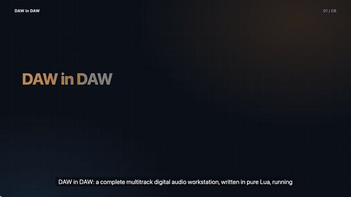](video/daw_in_daw_explainer.mp4)

<a id="video"></a>
Think "Neovim inside Neovim": REAPER supplies the host primitives (audio engine, MIDI, file I/O, undo, render, save format); this project supplies the **application**: its own arrangement view, piano roll, mixer,
effects rack, transport, file browser, export dialog, keyboard shortcuts and undo/redo workflow, drawn with REAPER's built-in `gfx` API. You can make, save and export a song without touching REAPER's normal editors.
It is about 3,597 lines of Lua in 22 files, with no dependencies beyond ReaScript and `gfx`.

<p align="center">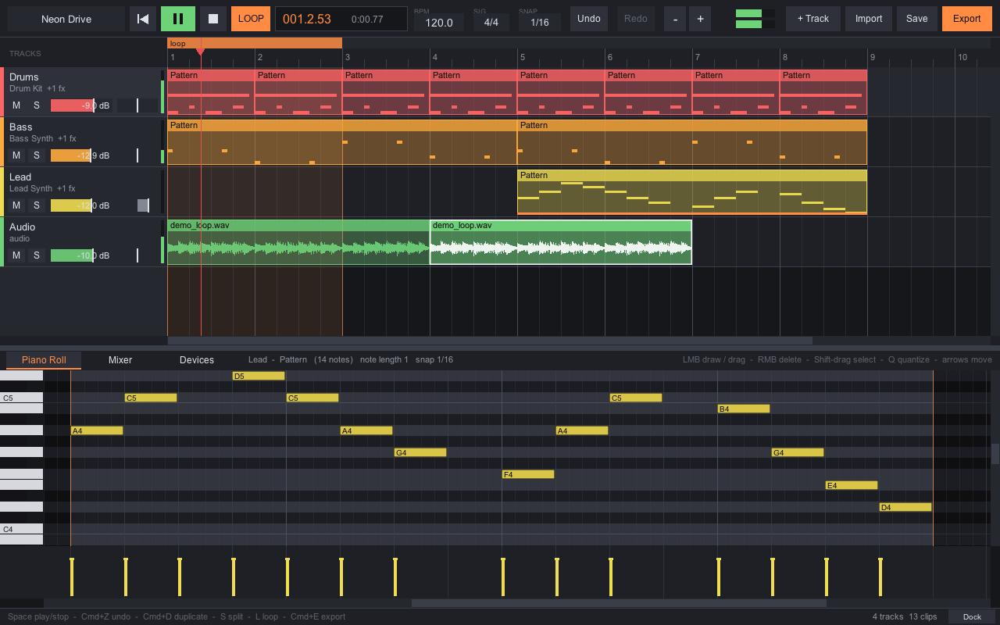</p>

▶ **Recorded demo (from the app's own framebuffer; audio is real renders of the project):** [`docs/demo/daw-in-daw-demo.mp4`](docs/demo/daw-in-daw-demo.mp4)
· 🎧 **The song made with it:** [`docs/demo/neon_drive_export.wav`](docs/demo/neon_drive_export.wav) (18 s), project [`examples/neon_drive.rpp`](examples/neon_drive.rpp)

<a id="quick-start"></a>

## 🚀 Quick start

```bash
git clone https://github.com/Bobliuuu/daw-in-daw && cd daw-in-daw
./run.sh                         # launches REAPER and runs daw.lua   (macOS: /Applications/REAPER.app)
./run.sh examples/neon_drive.rpp # ...with the example song loaded
```
Or inside REAPER: *Actions, Show action list, New action, Load ReaScript, `daw.lua`* (run it again to close it). `tools/install_action.sh` registers it as a named action.
Developed and tested on **REAPER 7.39, macOS 26, Apple Silicon** (older 6.x/7.x builds are untested).

<a id="how-it-works"></a>

## 🧩 How it works

* **One project, two interfaces.** Every track, clip, note, fader and effect *is* a REAPER object; open the same `.rpp` in REAPER's normal UI and you see ordinary tracks, items, MIDI notes and FX chains.
* **No dependencies.** Lua ReaScript + `gfx` only.
* **Owns the editing experience.** Its own toolkit (clip-rect stack, hit testing, mouse capture, popups, modal dialogs, sliders, scrollbars) renders every pixel.

<p align="center">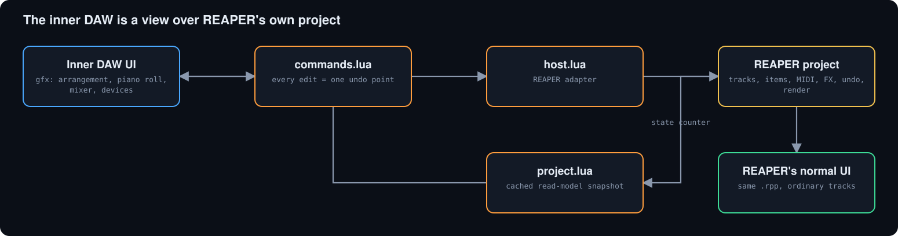</p>

<a id="features"></a>

## ✨ Features

| Area | What works |
|---|---|
| **Project** | new / rename / save / save-as / reopen and resume; schema-versioned metadata; your other tracks are never touched |
| **Tracks** | MIDI and audio tracks; Lead / Bass / Pad / Pluck presets (ReaSynth) and a 6-voice Drum Kit (ReaSamplOmatic5000, procedurally generated original samples) |
| **Arrangement** | ruler, loop strip, zoom/scroll, clip move/resize/trim, duplicate, copy/cut/paste, split, snap, real waveforms |
| **Piano roll** | draw, move, resize, pitch edit, velocity lane, marquee select, quantize, snap grid, key audition |
| **Audio** | import WAV / FLAC / MP3 / OGG / AIFF via an in-app file browser |
| **Mixer / Effects** | faders, pan, M/S, peak meters, FX slots; Reverb, Delay, EQ, Compressor |
| **Transport / Undo** | REAPER's native transport; every command is one undo point (a 100-frame drag is one entry) |
| **Export** | own dialog, REAPER's renderer, result analysed (duration, peak, RMS), never overwrites |

Full keyboard and mouse reference: [docs/README_FULL.md](docs/README_FULL.md).

<a id="tests"></a>

## ✅ Tests

```bash
lua tests/unit.lua            # pure-Lua unit tests, no REAPER needed
tools/run_all_tests.sh        # everything, incl. integration checks inside real REAPER  ->  docs/TEST_RESULTS.md
```
The table is read from the generated [docs/TEST_RESULTS.md](docs/TEST_RESULTS.md) (REAPER 7.39 on macOS). **GUI testing status:** the full song workflow is exercised through the app's real frame loop with synthetic input and the rendered framebuffer is inspected (screenshots below).
Posting *OS-level* mouse and keyboard events needs a macOS Accessibility permission that was not available, so `tools/gui/gui_test.sh` has **not been run to completion**; it refuses to report success when events are dropped. See [docs/TESTING.md](docs/TESTING.md).

| Checks passing | Failures | Pure-Lua unit tests |
|:---:|:---:|:---:|
| **598** | **0** | **354** |

**Test suites (docs/TEST_RESULTS.md, generated by tools/run_all_tests.sh)**

| Suite | Passed | Failed |
| :--- | ---: | ---: |
| unit: unit tests | 354 | 0 |
| legacy prototype build | 14 | 0 |
| legacy prototype reopen | 10 | 0 |
| engine_build | 76 | 0 |
| engine_verify | 12 | 0 |
| ui_build | 65 | 0 |
| ui_verify | 11 | 0 |
| example | 8 | 0 |
| extra_robust | 30 | 0 |
| extra_sizes | 12 | 0 |
| extra_perf | 6 | 0 |

<sub>Source: `results/derived/readme_data.json`</sub>

<p align="center">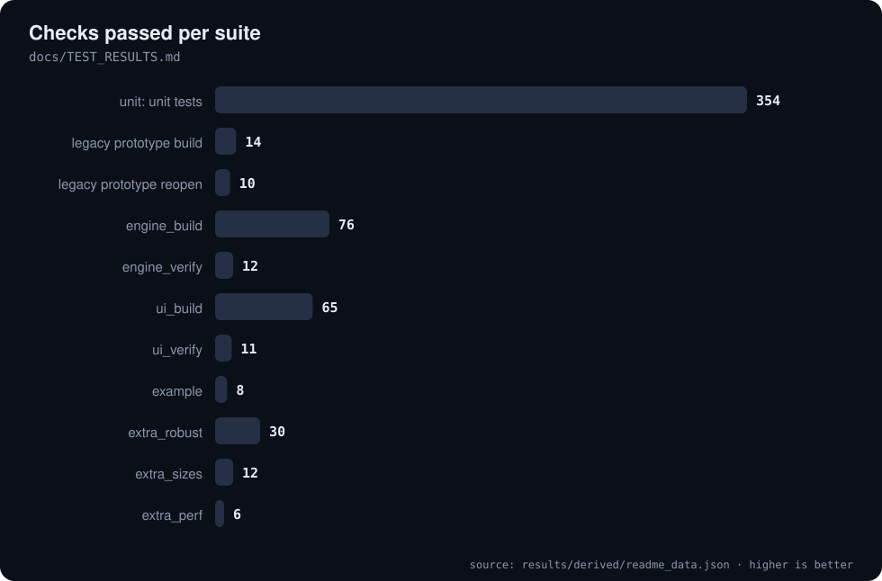</p>

<a id="performance"></a>

## ⏱️ Performance

16 tracks, 102 clips and 1,000 MIDI notes at 1280x800. Playback cadence in the recorded run: 33 fps (REAPER's `defer` scheduler sets the cadence). Details: [docs/ARCHITECTURE.md](docs/ARCHITECTURE.md).

| Idle, mean per frame | Dragging a clip | Playback, p95 |
|:---:|:---:|:---:|
| **1.5 ms** | **2.3 ms** | **8.1 ms** |

<p align="center">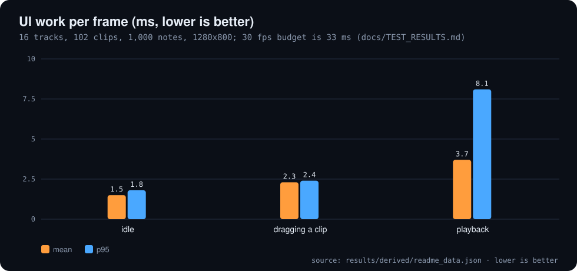</p>

<a id="screenshots"></a>

## 🖼️ Screenshots

| | |
|---|---|
| 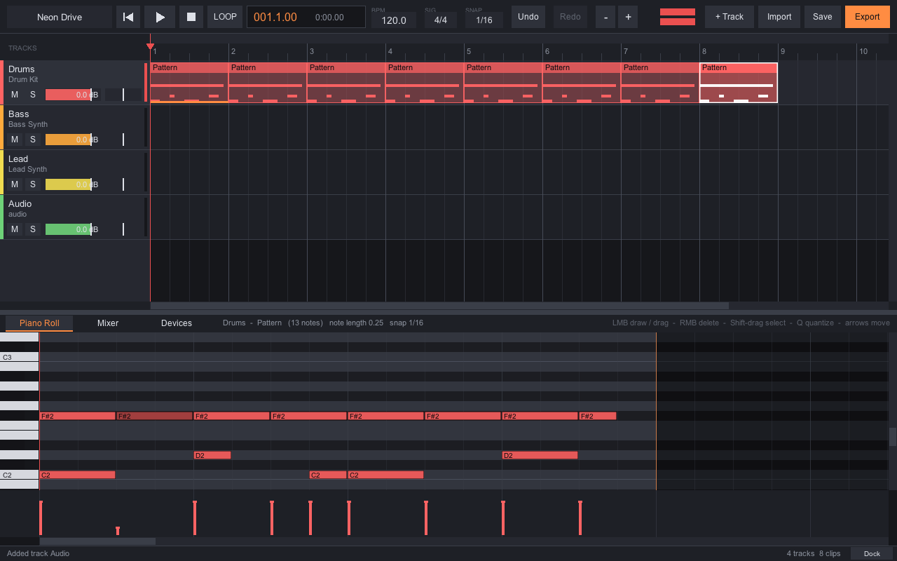 arrangement | 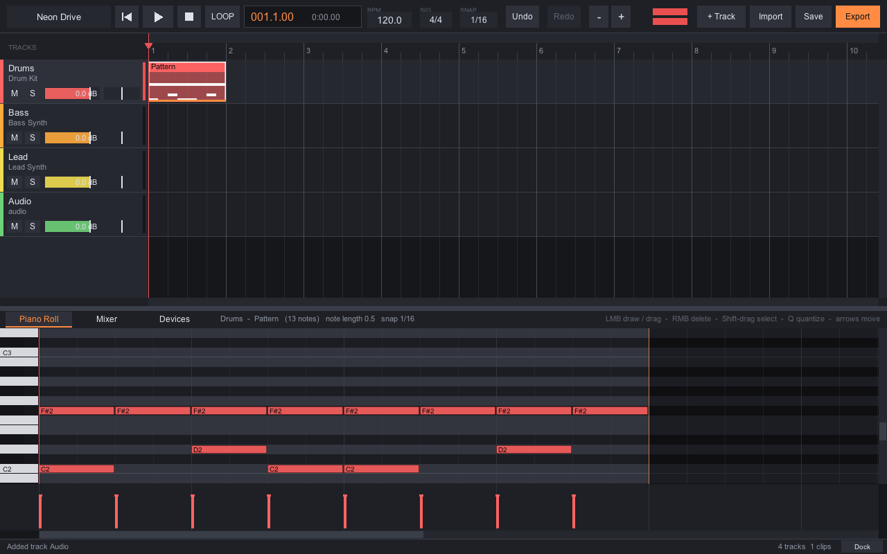 piano roll (drum kit) |
| 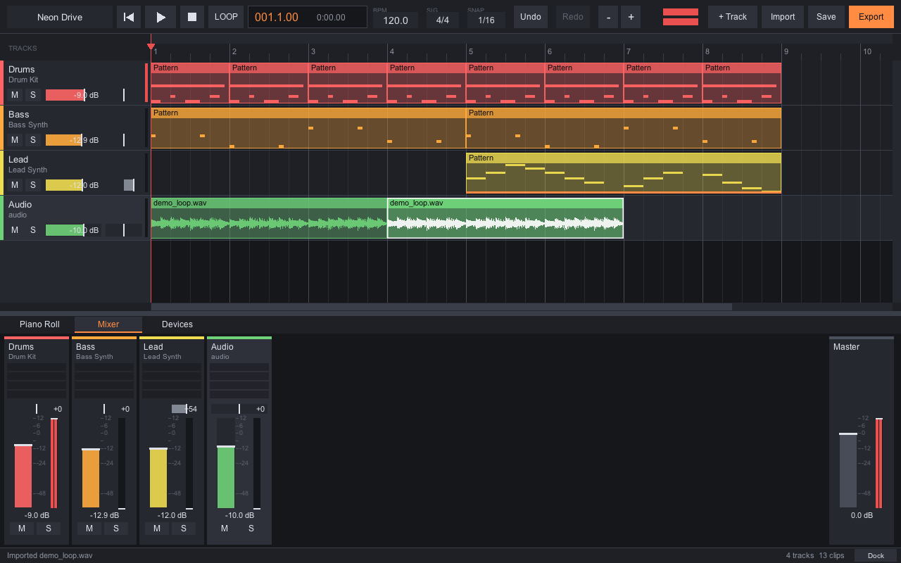 mixer | 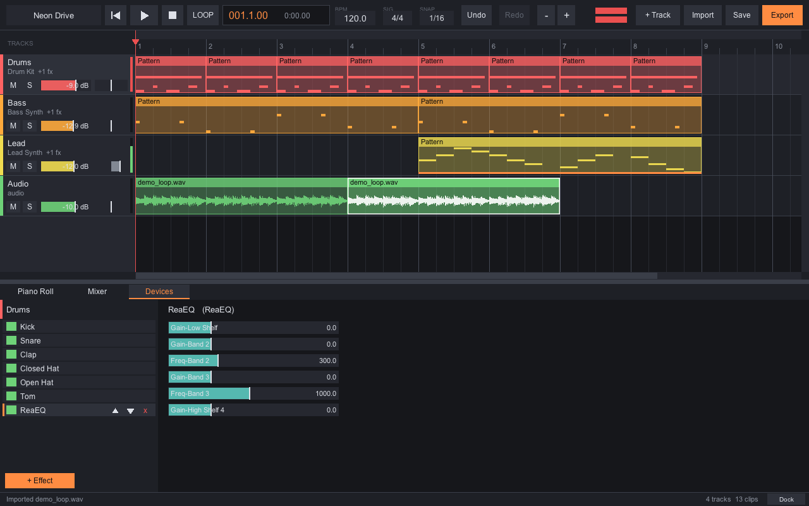 devices / effects |
| 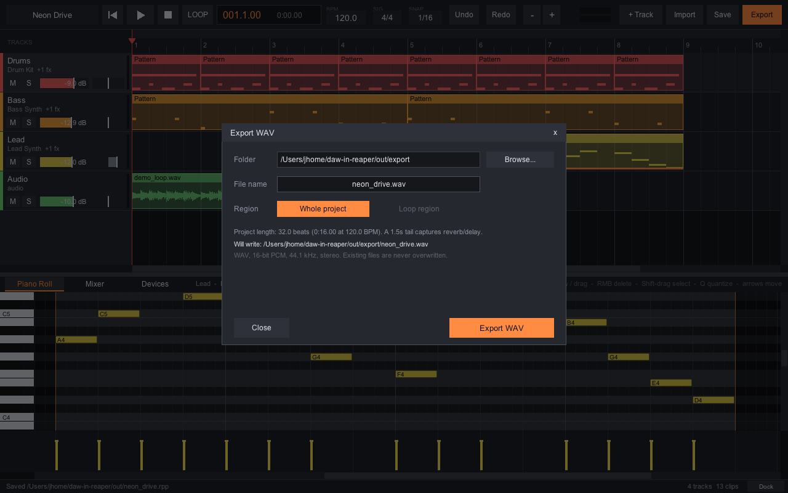 export | 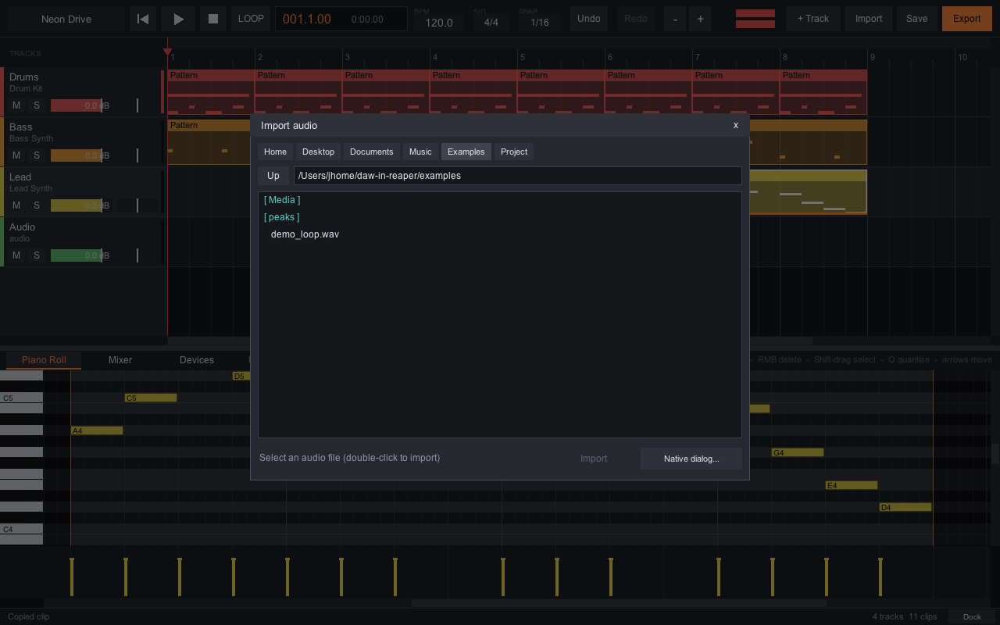 audio import browser |

<a id="caveats"></a>

## ⚠️ Honest caveats

- Developed and tested on **macOS 26 / REAPER 7.39 / Apple Silicon** only. Windows and Linux are untested.
- OS-level GUI automation (`tools/gui/gui_test.sh`) was not run to completion (needs a macOS Accessibility permission). The Dock button is tested; hand-dragging onto a docker is not automated.
- Single tempo and time signature at the project start; no tempo map editing, no automation lanes, no audio recording, no MIDI-device input.
- MIDI clips: right-edge resize only; overlapping clips are refused rather than layered. Export is REAPER's master mix, so non-DAW tracks in the same project are included.
- `gfx` text is single-font Arial without unicode or emoji.

<a id="repo-map"></a>

## 🗺️ Repo map

| Path | What it is |
|---|---|
| `daw.lua` | entry point (run this) |
| `src/` | app, project read-model, commands, host adapter, timeline, audio (instruments, effects, export) and ui (toolkit, arrangement, piano roll, mixer) |
| `tests/` | unit, in-REAPER integration, UI-driver and legacy prototype tests |
| `tools/` | runners, demo recorder, GUI test, readme_data.py |
| `examples/` | neon_drive.rpp (the demo song) and demo_loop.wav |
| `docs/` | architecture, testing, TEST_RESULTS.md, screenshots, recorded demo, README_FULL.md (the earlier long README) |
| `README.spec.yml` | spec for video-readme-maker |
| `video/` | explainer mp4, srt, poster, preview.gif (generated) |

---

<div align="center"><sub>Generated with video-readme-maker from README.spec.yml and docs/TEST_RESULTS.md.</sub></div>
